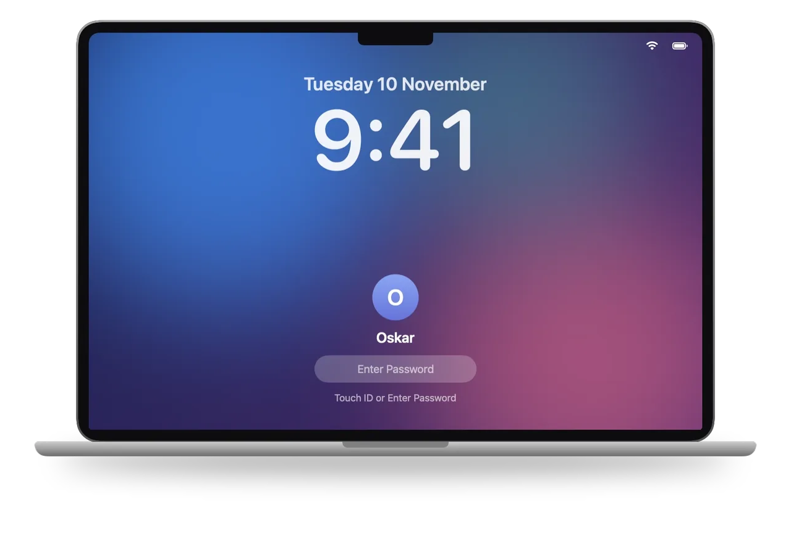
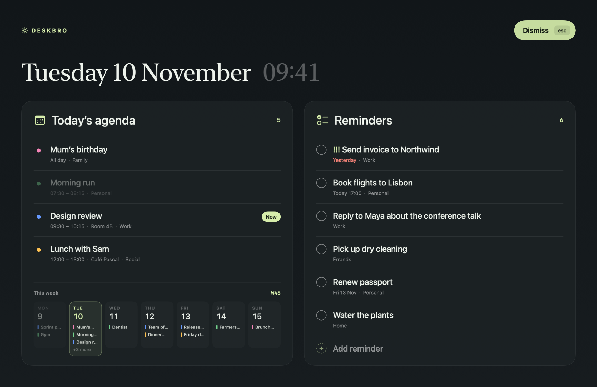

<p align="center">
  
</p>

<h1 align="center">DeskBro</h1>

<p align="center">
  <b>Your day, front and center.</b><br>
  A full-screen macOS dashboard for today’s calendar and your reminders — shown every time you unlock your Mac.
</p>

---

Notifications are easy to ignore. DeskBro isn’t: when you unlock your Mac it fills the screen with what matters today, so you actually see it. Glance at your agenda, tick off a reminder or add a new one, then press <kbd>esc</kbd> and get on with your day.

## Features

- **Today’s agenda** — every event today with its calendar colour, time and location. What’s happening *now* is tagged, what’s next counts down, and past events fade.
- **This week at a glance** — a compact strip of the whole week under the agenda.
- **Reminders** — all your open reminders, with due dates (overdue in red), lists and priorities. Tick them off, add new ones inline, and drag to reorder.
- **Shows up on unlock** — covers the screen when you unlock or wake your Mac. Dismiss with the button or <kbd>esc</kbd>.
- **Global shortcut** — open or close the dashboard from anywhere (<kbd>⌃</kbd><kbd>⌥</kbd><kbd>⌘</kbd><kbd>D</kbd> by default, configurable).
- **Lives in the menu bar** — no Dock icon. Optional launch at login.
- **Native and private** — SwiftUI + EventKit, sandboxed, no network access, no analytics. Works with any account you’ve added to Calendar and Reminders (iCloud, Google, Exchange…).

<p align="center">
  
</p>

## Install

You don’t need to be a developer or have an Apple developer account. You need **macOS 14 (Sonoma) or later**.

1. Open **Terminal** (press <kbd>⌘</kbd><kbd>Space</kbd>, type “Terminal”, press <kbd>Return</kbd>).
2. Paste this and press <kbd>Return</kbd>:

   ```sh
   git clone https://github.com/oskob/DeskBro.git && cd DeskBro && sh install.sh
   ```

3. **On a Mac that has never built software:** a dialog asks to install Apple’s *Command Line Tools*. Click **Install**, wait for it to finish (a few minutes, 1–2 GB), then paste the same line again.
4. DeskBro opens with a short setup: allow Calendar and Reminders, choose whether to open DeskBro at login, and pick a shortcut.

That’s it — DeskBro is in your menu bar. Because it’s built on your own Mac, there are no “unidentified developer” warnings and nothing to approve in System Settings. If you’re not an administrator, it installs to `~/Applications` instead of `/Applications`.

**Update:** `cd DeskBro && git pull && sh install.sh`

**Uninstall:** quit DeskBro from its menu bar icon and delete `DeskBro.app` from Applications. If you enabled *Open at login*, also remove it under System Settings → General → Login Items.

## Using DeskBro

| | |
|---|---|
| Show / hide the dashboard | <kbd>⌃</kbd><kbd>⌥</kbd><kbd>⌘</kbd><kbd>D</kbd>, or menu bar icon → **Show Dashboard** |
| Dismiss | <kbd>esc</kbd> or **Dismiss** |
| Complete a reminder | Click its circle |
| Add a reminder | Click **Add reminder** under the list, type, press <kbd>Return</kbd> |
| Reorder reminders | Drag them |
| Settings | Menu bar icon → **Settings…** |

In **Settings** you can turn the unlock dashboard on or off, toggle launch at login, and record a different shortcut.

New reminders go to your default Reminders list. The order you drag reminders into is kept by DeskBro (macOS doesn’t let apps read or change the Reminders app’s manual order).

## Privacy

DeskBro requests Calendar and Reminders access through macOS. It reads events and can create or complete reminders. The app contains no analytics or network client; account syncing remains managed by macOS. Preferences are stored locally with UserDefaults. The dashboard can show personal event details when opened or after wake/unlock; disable automatic display in Settings if desired.

## For developers

DeskBro is a plain Swift package — no Xcode project. You need Xcode or just the Command Line Tools.

```
Sources/DeskBro/     the app (SwiftUI + AppKit + EventKit)
Resources/           Info.plist, entitlements, AppIcon.iconset
build.sh             compiles with SwiftPM and assembles + signs build/DeskBro.app
install.sh           build.sh, then installs to /Applications and launches
```

```sh
./build.sh              # build only, into build/DeskBro.app
./install.sh            # build, install, launch
./install.sh --fresh    # …and reset onboarding + Calendar/Reminders permissions
```

To add a source file, drop it in `Sources/DeskBro/`.

**Signing.** Builds are ad-hoc signed by default. macOS ties Calendar/Reminders permission to the app’s signature, so an ad-hoc build asks again after every rebuild. If you have a signing certificate, use it to keep permissions across rebuilds:

```sh
SIGN_IDENTITY="Apple Development" ./install.sh
```

The generic bundle identifier is `org.example.DeskBro` (in `Resources/Info.plist`). Existing installations using another identifier keep separate preferences and permissions.

**Publishing source.** Publish source files only. Build products, signing credentials, environment files and Xcode user settings are excluded by `.gitignore`. Do not force-add them or upload the entire working folder as an archive. Review staged changes before each commit, and use a GitHub private/noreply commit email to keep your email address out of public history.

## License

Do whatever you want with DeskBro — use it, modify it, share it, build on it — **except publish it unmodified on the App Store** (or any other app store). Publishing a meaningfully modified version is fine. See [LICENSE](LICENSE) for the full terms.
